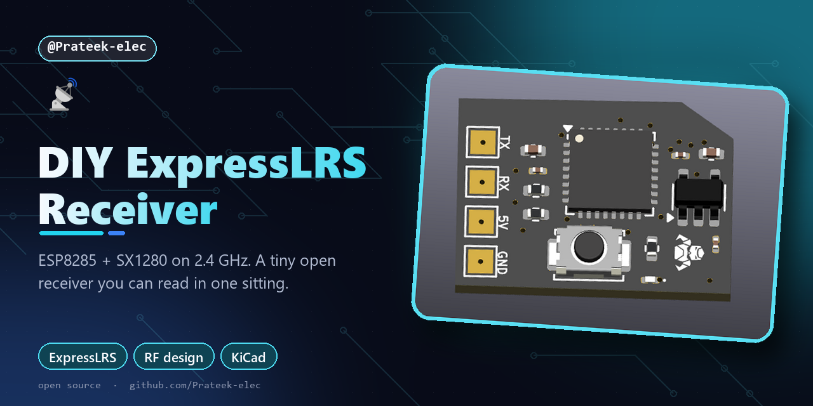
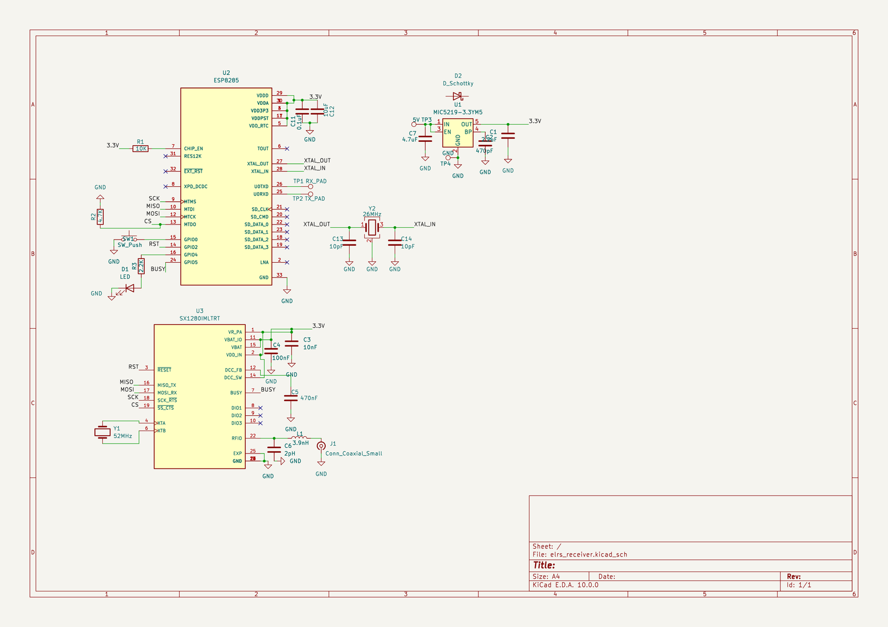
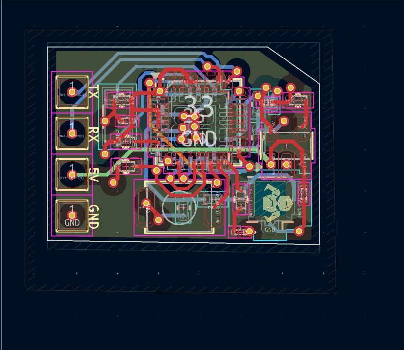

<div align="center">



**A tiny, open-source ELRS receiver you can study, modify and build: ESP8285 + Semtech SX1280, U.FL antenna, 4-pad UART output, designed in KiCad 9.**


</div>

---

## Highlights

- 📡 **2.4 GHz ExpressLRS:** the open RC link most FPV pilots fly today.
- 🔬 **See inside a receiver:** ESP8285 + SX1280, every trace visible.
- 🧩 **Tiny, double-sided layout:** MCU on top, radio and U.FL underneath.
- 🛠️ **KiCad source included:** fork it, shrink it, make it yours.

## What it is

[ExpressLRS](https://www.expresslrs.org/) is the open-source RC link most FPV pilots now fly. Commercial receivers are tiny and cheap, but you rarely see *how* they're built. This repo is the full hardware design for a minimal 2.4 GHz ELRS receiver, small enough to read in one sitting.

## Hardware at a glance

| Block | Part | Notes |
|---|---|---|
| MCU | **ESP8285** | ESP8266 core with built-in flash, the standard ELRS RX MCU |
| Radio | **Semtech SX1280** | 2.4 GHz LoRa / FLRC transceiver on SPI (with BUSY + RESET lines) |
| Reference clock | 52 MHz crystal | For the SX1280 |
| RF output | L-C network → **U.FL** coax | Plug in any 2.4 GHz dipole / T-antenna |
| Power | **MIC5219-3.3** LDO + Schottky diode | 5 V in, 3.3 V out |
| Interface | **TX · RX · 5V · GND** pads | Connects straight to your flight controller UART (CRSF) |
| Extras | Bind / boot button, status LED, UART test points for flashing | |

The board uses double-sided placement: the MCU and pads on top, the radio and antenna connector underneath.

## Design files

<table>
<tr>
<td width="50%"><br/><sub><b>Schematic</b>: <code>hardware/kicad/elrs_receiver.kicad_sch</code></sub></td>
<td width="50%"><br/><sub><b>PCB layout</b>: <code>hardware/kicad/elrs_receiver.kicad_pcb</code></sub></td>
</tr>
</table>

## Open it yourself

1. Install [KiCad 9](https://www.kicad.org/download/).
2. Clone the repo:
   ```bash
   git clone https://github.com/Prateek-elec/elrs-receiver-pcb.git
   ```
3. Open `hardware/kicad/elrs_receiver.kicad_pro`.

## Known issues

- **ESP8285 has no crystal (rev A).** `XTAL_IN` (pin 28) and `XTAL_OUT` (pin 27) on U2 are unconnected, so the MCU won't boot as drawn. The 52 MHz crystal Y1 belongs to the SX1280 radio. **Fix for rev B:** add a 26 MHz crystal (3.2 × 2.5 mm) between pins 27 and 28, with load capacitors to GND sized for the crystal's load capacitance, placed as close to U2 as possible. See Espressif's ESP8285 reference design.

## Roadmap

- [x] Schematic
- [x] PCB layout
- [ ] Gerbers + BOM
- [ ] Bring-up, flashing ELRS firmware and range test

> **Note:** this is a learning design that hasn't been flight-tested yet. Check the RF layout, matching network and ESP8285 clock circuit against the reference designs before you rely on it in the air.

## Contributing

RF folks: reviews of the matching network and layout are very welcome. [Open an issue](https://github.com/Prateek-elec/elrs-receiver-pcb/issues).

## License

[MIT](LICENSE) © Prateek Sarkar

---

<div align="center">

### Found this useful?

**Drop a ⭐ so more builders find it, and share it with someone who'd build one.**

[](https://twitter.com/intent/tweet?text=Ever%20wondered%20what%27s%20inside%20an%20ExpressLRS%20receiver%3F%20%F0%9F%93%A1&url=https%3A%2F%2Fgithub.com%2FPrateek-elec%2Felrs-receiver-pcb)
[](https://www.linkedin.com/sharing/share-offsite/?url=https%3A%2F%2Fgithub.com%2FPrateek-elec%2Felrs-receiver-pcb)
[](https://github.com/Prateek-elec)

</div>
